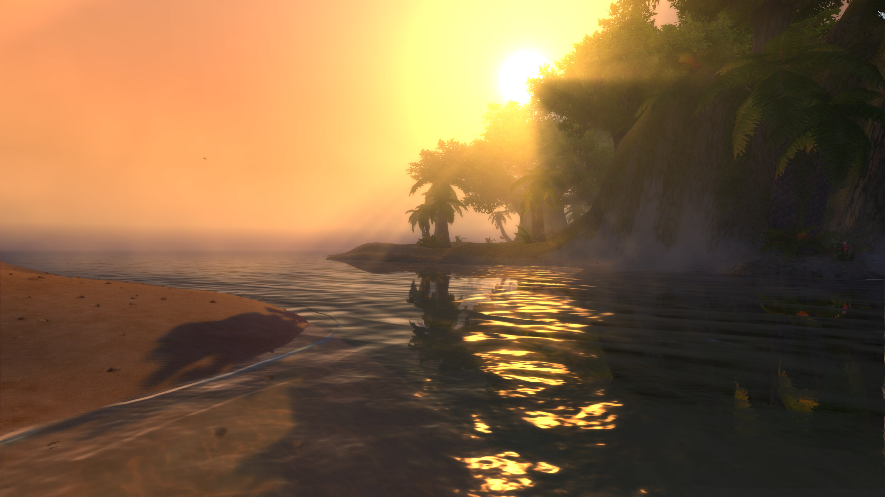
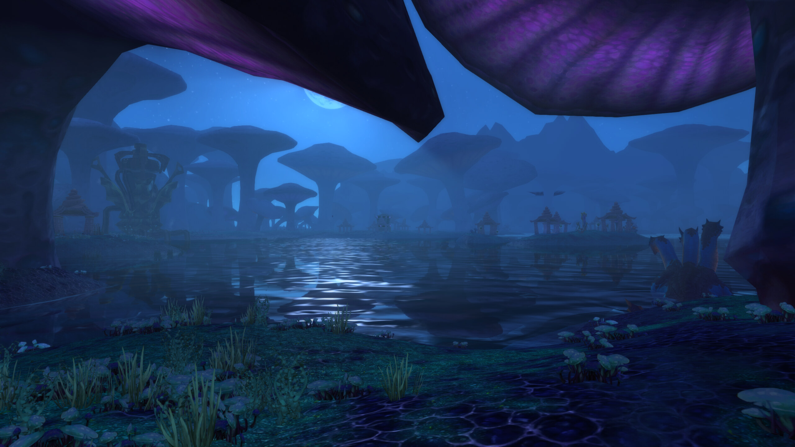
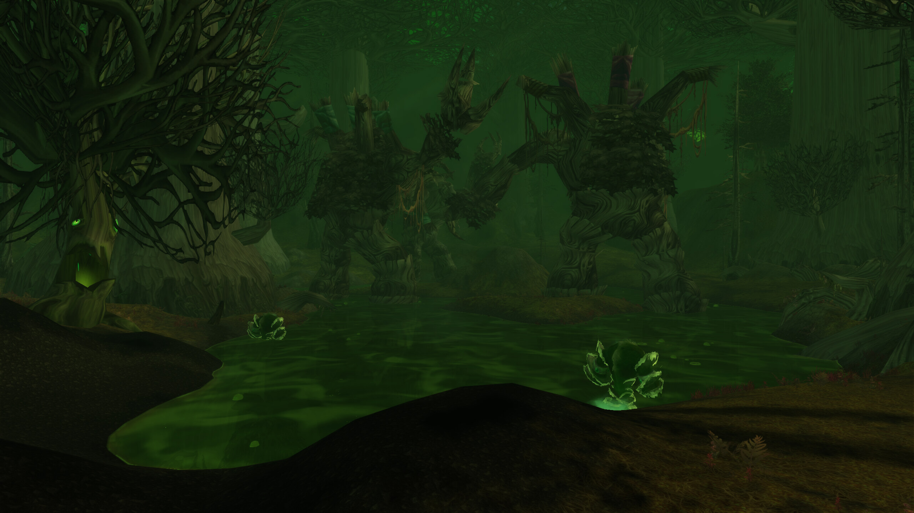
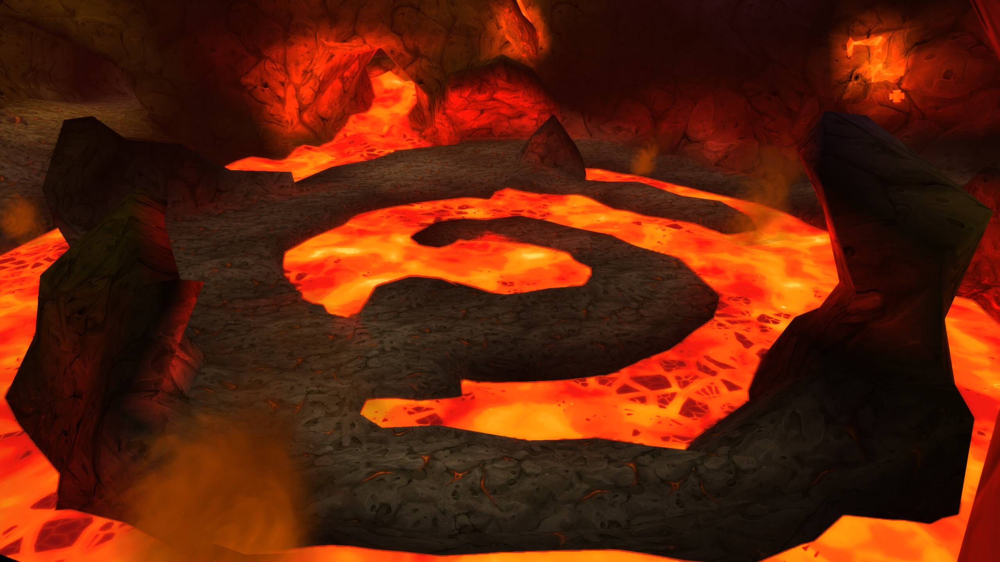
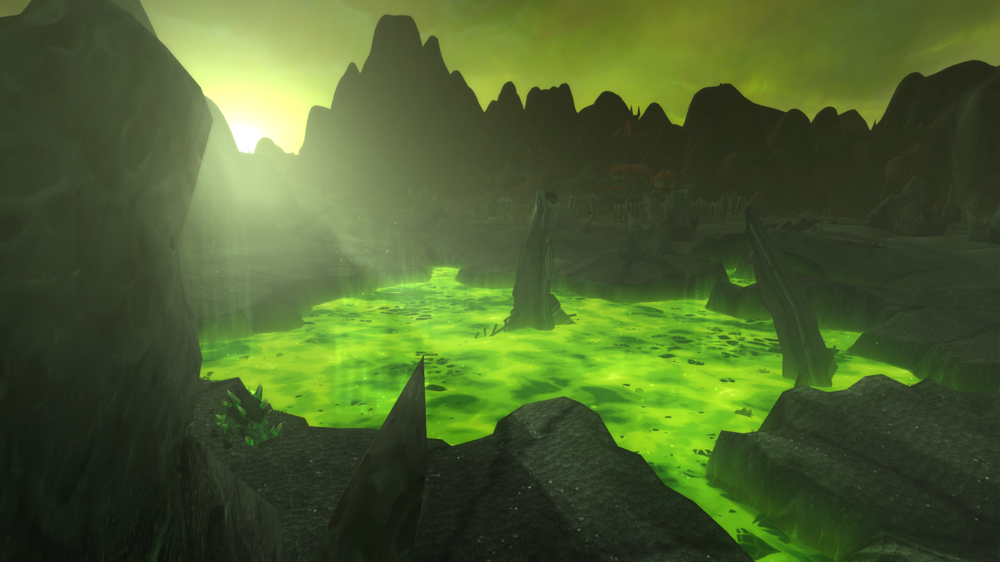

# Northlight + Tideglass

Northlight adds lighting, shadows, skies and fog. Tideglass adds waves, underwater effects and reflections, from a Nagrand lake to the green canals of Undercity. This beta pairs them for **World of Warcraft 3.3.5a, build 12340**.

## Get the beta

When a combo build is published, open **Assets** on its GitHub release. Choose the ZIP with **tideglass** in its name and **Windows** or **Linux** at the end. If those files are absent, that release has no combo installer. The installer includes everything it needs to run. [GitHub releases](https://github.com/lepola/northlight/releases)

## Install

1. Close WoW. Extract the whole ZIP somewhere outside your game folder, such as Downloads. Keep the extracted folder for uninstall.
2. **Windows 10 or 11 (64-bit)** — double-click `Install.cmd`. **Linux (x86-64, Wine or Proton)** — open a terminal in the extracted folder and run `bash install.sh`.
3. When asked for the game folder, paste the path to the folder containing **Wow.exe**, or drag the executable into the prompt and press Enter. Press **Enter** for the default sky and dungeon choices. The first install builds outdoor lighting from your game files. Allow about **20–40 minutes**, **13 GB free** on the game drive and **8 GB RAM**. If interrupted, run the installer again to resume.
4. **Linux only** — set your launcher to load the game's copy of `d3d9.dll` before starting WoW. Use the instructions for your launcher below.
5. Launch WoW as usual. Visit a shore with trees or buildings across the water. Turn along the bank to see their reflections, then dip the camera underwater.

Linux setup for Steam, Lutris, Bottles or plain Wine

- **Steam/Proton** — in the game's **Properties → Launch Options**, enter `WINEDLLOVERRIDES="d3d9=n,b" %command%`.
- **Lutris** — in **Configure → Runner options → DLL overrides**, add `d3d9` with value `n,b`.
- **Bottles** — in the bottle's **DLL Overrides**, set `d3d9` to **Native, then Builtin**.
- **Plain Wine** — from the game folder run `WINEDLLOVERRIDES="d3d9=n,b" wine Wow.exe`.

## What the defaults give you

Reflected scenery, shaped ocean waves, underwater effects, slime and magma run alongside Northlight's zone skies, weather, lighting and fog. The installer includes the raised-city fog fixes for Dalaran and Telredor and repairs four known HD dock and plant textures when it finds the affected versions. Dungeon and raid lighting can be added later by running the installer again.

| Marsh water | Slime |
| --- | --- |
|  |  |

| Magma | Fel magma |
| --- | --- |
|  |  |

Your game supplies the artwork, so stock and HD clients can look different. The installer preserves existing game archives, realm settings and add-ons. Install and rollback have been checked on stock and modified client copies. Beta 5 also ran in-game on native Windows with updated graphics drivers. Native Windows rollback and compatibility with individual realms, including Warmane, still need confirmation.

## Change settings or roll back

The in-game Water page is included in builds after beta 5. In beta 5, you can adjust water tuning in the game folder's `water.ini`.

- **Adjust lighting and water in game** — press **Ctrl+Shift+F11**. On **Water**, adjust waves, foam, reflections or underwater visibility and choose **Save** to see the change. [Settings guide](renderer/docs/settings-menu.md)
- **Keep Northlight and use the game's water** — on **Water**, clear **Use Tideglass**, choose **Save** and restart WoW. Beta 5 users can set `Enable=0` in `water-host.ini` with the game closed.
- **Remove the combo** — close WoW and run `Uninstall.cmd` (Windows) or `bash uninstall.sh` (Linux) from the extracted package. Select the same game folder. This restores the previous renderer and keeps edited water settings.
- **The game closes at startup** — try the older bundled graphics backend. Open a terminal in the extracted package and run `.\Install.cmd --backend dxvk2` on Windows or `bash install.sh --backend dxvk2` on Linux.
- **Report a visual problem** — include the package version, zone, time of day and what you did just before it happened. For flicker or a hitch, say whether it happens while turning, moving or holding still. A screenshot or short clip helps.

For build instructions, renderer settings and test commands, see the [contributor and renderer reference](renderer/docs/northlight-reference.md). [License](LICENSE)
