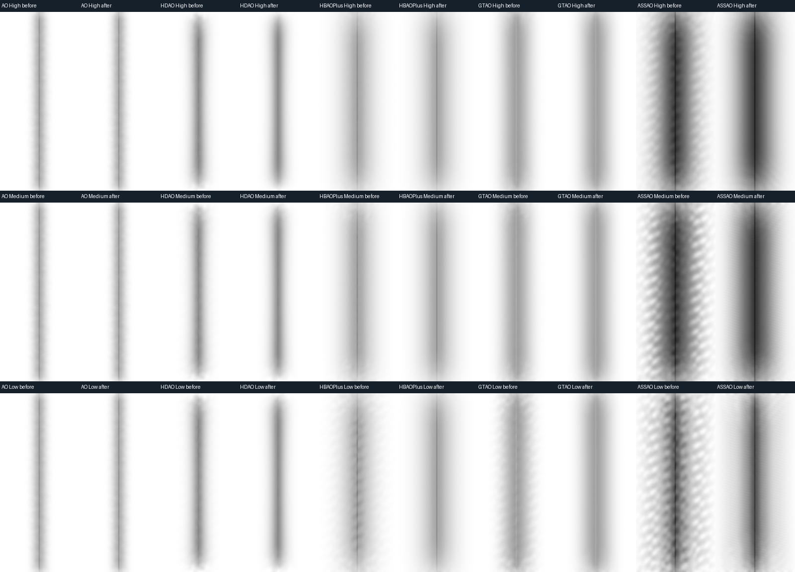

# AO methods for the D3D9 Northlight renderer

Set these keys in `[Quality]` in `northlight-quality.ini`, or use Lighting & AO
in the Northlight menu and Apply. Changes apply between frames:

```ini
ContactAO=1
AOMethod=GTAO
AOQuality=High
AOStrength=100
AORadius=200
```

| AOMethod | Implementation |
| --- | --- |
| SSAO / 0 | Original Northlight 8-tap SSAO. Default; unchanged at strength 100 and radius 200. |
| HDAO / 1 | AMD AOFX-style paired valley detection, 16 pairs. D3D9 adaptation. |
| HBAOPlus / HBAO+ / 2 | D3D9 adaptation of the NVIDIA HBAO+ coarse kernel: 8 directions, 4 radial steps, normal bias, squared-distance falloff. |
| GTAO / 3 | Cosine-weighted horizon integration, 4 slices and 4 paired steps. |
| ASSAO / 4 | Intel ASSAO fixed-quality kernel adapted to D3D9: weighted progressive paired samples, distance falloff, halo reduction and detail AO. |

Names are case insensitive. Invalid values retain the previous value and produce a
QUALITY warning. `AOStrength` is 0..200 percent; 100 preserves the existing
strength scale. `AORadius` is 10..1000 hundredths of a yard; 200 means 2 yards.
`ContactAO=0` disables any selected method and its filter; bloom remains enabled.

`AOQuality` accepts High/0, Medium/1 and Low/2. Every preset keeps High, preserving
the existing sample counts. Lower levels are explicit choices that reduce depth
taps; SSAO ignores the quality setting.

| Quality | GTAO slices x paired steps | HBAO+ directions x steps | HDAO pairs | ASSAO pairs |
| --- | --- | --- | --- | --- |
| High (default) | 4 x 4 | 8 x 4 | 16 | 12 |
| Medium | 3 x 4 | 6 x 3 | 8 | 5 |
| Low | 2 x 4 | 4 x 4 | 8 | 3 |

HDAO Medium and Low currently compile to the same kernel. ASSAO Low omits the
detail/edge/halo calculations; Medium and High retain them. ASSAO has its own
visibility response and can produce stronger contact shading at the same
`AOStrength` than the other methods. The defaults remain SSAO/High.

Lower counts can increase fine noise and shimmer during camera motion. The blur
and half-resolution targets are unchanged. Quality selection is saved on Apply;
it does not use the method selector's unsaved live preview. No measured whole-game
FPS gain is implied by the lower sample counts.

All methods use the existing half-resolution targets and the depth/normal-aware
AO filter. Sky and water receivers are excluded. Each method runs in both the
world-GI and fallback paths; the fallback keeps the original simple colour bounce.
GI continues to supply colour bounce when the world renderer is ready.
The advanced methods need one extra alpha-only draw in the fallback path to
retain its original colour bounce within the Shader Model 3 instruction limit.
That draw uses `*Only` bytecode and skips five discarded scene-colour/bloom taps.
HDR also uses `*Only`: it uses the same AO calculation and builds bloom separately
from linear radiance. The SDR world path uses `*ContactBloom` to fold bloom into
the existing world composite. AO render-target size and format are identical
in SDR and HDR, so HDR does not inherently double AO bandwidth.
The startup log records the selected method, strength, radius and enabled state.

These are D3D9 adaptations, not the complete NVIDIA HBAO+ SDK, Intel ASSAO or XeGTAO
pipelines. There is no DX11 deinterleaving, depth-mip hierarchy or extra temporal
AO pass. Each quality level has fixed sample counts. Quality and GPU cost still need
comparison in actual gameplay; a synthetic device test is not an in-game FPS test.

VXAO is not implemented: NVIDIA VXAO requires voxelizing scene geometry and
tracing the resulting volume, rather than reading the screen depth buffer.
It cannot be enabled through this screen-space method selector. An unsupported
`AOMethod=VXAO` is rejected instead of silently selecting a different algorithm.

Validation: `python tests/test_ao_methods.py` compiles an independent x86 hidden
D3D9 test device and exercises the production bytecode through DXVK 2. It checks
flat and tilted planes, concave corners, a separated foreground silhouette,
sky, water and strength zero in both composition paths. It also checks named
and numeric INI values, rejection of unsupported values, distinct kernel
outputs, and byte-identical original SSAO/filter/composite payloads.

Algorithm references:

- [AMD AOFX HDAO kernel](https://github.com/shadercoder/AOFX/blob/master/amd_aofx/src/Shaders/AMD_AOFX_Kernel.hlsl)
- [NVIDIA HBAO+ coarse kernel](https://github.com/NVIDIAGameWorks/HBAOPlus/blob/master/src/shaders/src/CoarseAO_PS.hlsl)
- [Jimenez et al., Practical Real-Time Strategies for Accurate Indirect Occlusion](https://www.activision.com/cdn/research/Practical_Real_Time_Strategies_for_Accurate_Indirect_Occlusion_NEW%20VERSION_COLOR.pdf)
- [Intel XeGTAO implementation](https://github.com/GameTechDev/XeGTAO)
- [NVIDIA VXAO requirements](https://developer.nvidia.com/vxao-voxel-ambient-occlusion)

Third-party notices for the adapted kernels are in `licenses/ao-methods.txt`.

## ASSAO implementation and validation

The implementation follows Intel ASSAO's fixed Q0/Q1/Q2 sample budgets (Low,
Medium, High), progressive sample positions/weights, near-camera radius limiter,
obscurance falloff, halo weights, edge-sensitive detail and visibility curve.
The source is [Intel ASSAO at c21d57a](https://github.com/GameTechDev/ASSAO/tree/c21d57a95b43c700ee01a2eb18f5589d7becefb2),
under MIT. Northlight supplies depth-derived normals, its existing pixel rotation,
native depth sampling and bilateral filter. The adaptation adds six SM3 shaders,
with no additional textures, preparation passes or runtime dependencies.

Adaptive Q3 importance sampling, deinterleaved depth arrays and depth mips are
not implemented. This is not a byte-identical port of the DX11 pipeline or a
verified reproduction of WoW Forever's integration. The actor thickness correction
below remains specific to HBAO+/GTAO High; ASSAO uses ordinary screen depth.

Snapped zero-offset samples are explicitly excluded: reconstructing the receiver
twice can produce a tiny delta under fused arithmetic, whose normalization causes
false darkening on distant terrain. A D24 grazing regression reproduced this on
DXVK 3 before the fix and passes on both packaged backends afterward.

`tests/test_ao_quality.py` runs all five methods at all three qualities: 183 cases
per quality, exact SDR/HDR AO equality and preservation of fallback RGB. GTAO and
ASSAO each have 48 grazing-plane/convex/concave cases per quality. ASSAO additionally
has 1,152 comparisons per quality covering odd/even dimensions, FP16/FP32,
0/2/4/8x MSAA, two depth partitions including nonzero MinZ, and radii 0.1/2/10yd.
The test checks compiled loop budgets and the approved High payload hashes.
Settings and shader/resource lifetime tests cover all five methods and live switches.

## Visual regression lab



Synthetic corner, WorldComposite visibility, 160-pixel centre crops from
640x360 input. Each pair is before/after, without contrast stretching.

Run the independent Windows GPU lab with NumPy and Pillow installed:

```sh
python tests/test_ao_pipeline_gpu.py --output out/ao-lab
```

Open `out/ao-lab/index.html`. Each sheet compares SSAO, HDAO, HBAO+, GTAO and
ASSAO at one quality. Its four rows are the production raw kernel, FP16 AOBlur,
legacy Composite and WorldComposite. White means fully visible; images have no
contrast stretch. The world pass uses neutral lighting/fog to isolate AO.

The default matrix contains 24 authored D24 scenes (640x360 and 641x361), three
qualities and five methods: 1,440 stage images. It covers flat/tilted surfaces,
vertical/horizontal/diagonal corners, a small camera dolly, grazing contact,
smooth/grooved cylinders, a separated silhouette, sky and water. The test checks
finite visibility, open surfaces, retained contact and residual pattern energy
on both corner orientations. Pattern budgets are expressed in 8-bit visibility
levels and allow more noise at Low. `report.json` records metrics and loaded
bytecode/backend hashes. This is synthetic visual validation, not gameplay or FPS.

Use `--backend PATH` for another standalone D3D9 backend, `--size 1920x1080`
for a native-resolution inspection, and `--compare out/ao-lab-before` for
before/after contact sheets. `--compiled DIRECTORY` replays saved bytecode;
`--observe` records expected failures when investigating an old build.

The November 1 rotation fix replaces two correlated sawtooth values normalized
into a direction with a uniformly distributed angle. The old function produced
diagonal bands that survived the bilateral filter, most visibly in ASSAO.
Symmetric kernels use an angular sweep appropriate to their sample budget;
the same function also serves the HBAO+/GTAO actor variants. Sample counts,
strength, radius, targets and the filter are unchanged. The SSAO bytecode is
unchanged. HDAO's paired-valley kernel still responds weakly to fine grooves,
and the sparse Low kernels retain more noise than High. These are method/sample
budget limits, not claims of parity with the full upstream pipelines.

The saved November 1 comparison reduces corner-pattern RMS after AOBlur by
4.53x/4.27x/3.66x for ASSAO High/Medium/Low, and about 6.8x for both HBAO+ Low
and GTAO Low. Mean visibility stays within 0.0005 in that scene. The visual
matrix and the existing quality/grazing/grid tests pass on packaged DXVK 2.7.1
and 3.1.1. Actor AO passes the independent ray-reference checks on both.

To time a saved before/after pair without requiring pixel equality:

```sh
python tests/benchmark_ao_rotation_gpu.py --before out/ao-lab-baseline/compiled --backend /path/to/d3d9.dll --output out/ao-timing
```

This reuses the footprint stand's ABBA queries. Its default exact-pixel oracle
remains enabled; only the explicit `--measure-changed-output` mode permits the
intentional sampling differences. The benchmark warms 1,024 draws, then retains
12 batches of 64 draws per variant. On RTX 4090, with 1920x1080 inputs and FP16
960x540 AO targets, median paired changes over nine scenes were:

| Low kernel | DXVK 2.7.1 delta, ms | DXVK 3.1.1 delta, ms |
| --- | ---: | ---: |
| HBAO+ Only | -0.008624 | -0.005208 |
| HBAO+ ContactBloom | -0.009552 | -0.005728 |
| GTAO Only | -0.002192 | -0.000624 |
| GTAO ContactBloom | -0.000800 | -0.001872 |

These are elapsed raw-kernel query intervals, including possible submission
gaps. They show no median kernel regression on this device, not a guarantee
about whole-game FPS, other GPUs, or the complete AO/filter/composite cost.

For measured costs and limitations, see the AO section of
[the 2026-11-01 pipeline audit](pipeline-performance-audit-20261101.md).

## Thin actor occluders (#106)

Advanced AO can interpret a shin's front depth as a solid wall extending behind
the character. The actor correction measures a bounded visible silhouette width
and integrates a finite occlusion band instead. GTAO keeps the original
environment horizon; HBAO+ keeps its normal bias and distance kernel and scales
only the actor contribution by finite slice coverage. A global depth-difference
cutoff is deliberately avoided because it erases genuine wall/ledge occlusion.

Ownership comes from stencil bit `0x40` written by the native depth-writing draw;
there is no second M2 geometry draw or native shader patch. Floating names keep
their separate `0x80` bit. The first pending name-mask clear runs before actor
tagging, and materialization clears the actor bit again. Only fully actor-owned
MSAA pixels receive thickness correction. Unknown state, missing stencil or a
depth snapshot mismatch retains the original AO. Native MSAA with an already
occupied MRT is declined; packaged DXVK 2/3 explicitly verified by the oracle can
use that combination. [D3D9's MRT restrictions](https://learn.microsoft.com/en-us/windows/win32/direct3d9/multiple-render-targets)
do not guarantee antialiasing with MRT.

Contact protection samples a quarter-yard region on the receiver, including a
small lifted volume so shallow camera pitch does not hide the foot. Actor
receivers retain their existing self-occlusion. A width above one yard or a
silhouette without both measured boundaries retains baseline thickness. The
width is a conservative screen-space estimate, not a back-face depth measurement.

HBAO correction has full confidence through 2yd and fades to baseline between
2 and 3yd. At 3yd and above the original HBAO shader runs with no ownership work:
the unrestricted finite approximation underestimates real large-radius AO in
the regression scenes. Those settings retain their existing halo behavior.
GTAO keeps the finite band at larger radii; it improves reference error but does
not promise to eliminate every high-radius halo. Radii <=0.5yd and strength zero
use the original path. These limits are automatic and do not rewrite settings.

Device creation reserves D24S8 when either ContactAO or NameMask needs it,
subject to the existing format support checks. It has the same 24-bit depth
precision and 32-bit storage as D24X8. This also permits a live SSAO-to-GTAO
switch with NameMask disabled. If both consumers were disabled at creation,
enabling the correction can require a device reset to obtain stencil.

The correction reuses the existing half-resolution AO ping-pong target for
temporary normals/contact flags. Its full-resolution ownership texture and
matching MSAA surface are lazy; frames without eligible actors need neither
private mask pass. Switching off the feature's consumers releases its retained
resources. `AO_ACTOR` diagnostics report stamp counts, validity, use and sampled
CPU cost; `AOActorPrepare` and `AO` distinguish GPU preparation from the kernel.
Legacy alpha-only variants retain color bounce and skip discarded bloom reads.

Offline validation, without a client or game launch:

```sh
python tests/test_ao_actor_build.py
python tests/test_ao_actor_reference.py
python tests/test_ao_actor_gpu.py
python tests/test_ao_actor_stencil_gpu.py
```

The GPU tests require Windows and use hidden independent D3D9 devices;
`--compile-only` builds them without executing GPU work. `--backend` selects an
explicit backend DLL. The authored compressed fixtures contain six camera views,
a true wall, a thick skinned control and sky, with independent cosine-ray truth.
Additional radius cases check the HBAO confidence transition and exact baseline
dispatch at larger radii. The far fixture uses 1728x1117 so its contact ROI is
not under-sampled. Both world
and legacy composition paths must preserve nonuniform bloom/bounce RGB exactly.
Regenerate the fixtures with `python scripts/generate_ao_actor_fixtures.py`.

Use `--benchmark` for paired warm microbenchmarks. They report CPU submission and
GPU timestamp intervals separately; those intervals can include submission gaps.
These measurements are not proof of unchanged in-game FPS or Apple GPU cost.
