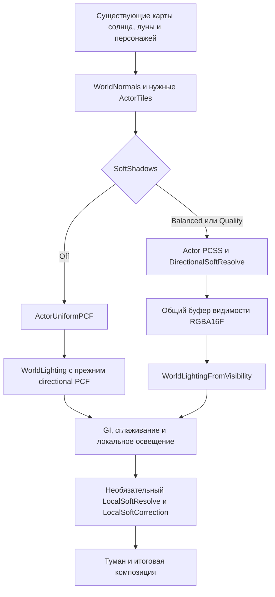

# Contact hardening shadows для Northlight

Исторический проект от 1 ноября 2026 года. Фактическая реализация и результаты проверок описаны в [PCSS extension](pcss-filter-extension-20261101.md). Ниже сохранено исходное исследование.

Рекомендуемый путь — расширить существующий PCSS на готовых картах теней, выделив обработку видимости в отключаемый этап. Геометрию, число кубов и расписание их обновления этот этап не меняет. В исходном плане первый этап охватывал солнце, луну и персонажей; второй добавлял мягкие тени для одного или двух значимых локальных источников.

На момент исследования были проверены только отдельные прототипы. Последующее расширение PCSS уже подключено к рендереру: SoftShadows=0|1, солнце/луна и все готовые выбранные локальные источники. Первоначальный план уровней 0|1|2 и ограничения на 1–2 локальных источника ниже не описывает итоговую реализацию. Игровые файлы не изменены.

## Что уже реализовано

| Подсистема | Текущий способ | Где смотреть |
| --- | --- | --- |
| Солнце и луна, окружение | Растеризация near/far shadow maps; фиксированный PCF, 25/16 выборок | `shaders/world_effects.hlsl`: `shadowMap`, `directionalShadow`, `WorldLighting` |
| Ближние персонажи и маунты | Отдельная карта 1024² на область 24×24 world units; отдельный half-res PCSS | `ActorShadow`, `ActorTiles`; `src/shadows/actor_shadow_map.h` |
| Локальные источники | R32F cubemap 256² на грань; четыре PCF-выборки | `shaders/local_light_effects.hlsl`: `localVisibility`; `world_point_rendering.inl` |
| GI | CPU-трассировка BVH на фоновом worker, включая shadow rays в расчёте переноса света | `src/gi/world_gi.cpp`: `BVH::trace`, `BVH::occluded`, `transport` |

Таким образом, трассировка в проекте действительно есть, но она обслуживает GI. Готового GPU-прохода ray traced direct shadows в исследованном пути нет. `ActorShadow` уже даёт требуемый принцип CHS: резкий контакт и расширение полутени с удалением blocker от receiver. Сейчас поиск содержит 41 выборку, затем выполняется непрерывный tent-фильтр до 81 выборки. Для большинства освещённых пикселей четыре чтения tile minima позволяют завершить работу раньше.

[AMD ShadowFX](https://github.com/GPUOpen-Effects/ShadowFX) реализует CHS через фильтрацию карт теней и рассчитан на DX11/DX12 с SM5. Для нашего D3D9/SM3 целесообразен собственный совместимый фильтр на имеющихся ресурсах. Отдельный [AMD Hybrid Shadows](https://github.com/GPUOpen-Effects/Hybrid-Shadows) использует DXR 1.1; это иной архитектурный путь.

CPU BVH полезен как эталон для тестовых сцен. Использовать его для каждого экранного пикселя в runtime не предлагается: уже один луч на пиксель half-res 1080p при 60 кадрах/с требует 31,1 млн запросов/с на источник, без учёта мягких теней и обновления геометрии. Screen-space ray marching можно рассматривать позже для мелких контактных деталей, но он ограничен видимой глубиной и не заменяет внеэкранных blockers.

## Связь с оптимизацией Штормграда

В исходном `qa_report/northlight-renderer.log` найдены 19 GPU-срезов с `ActorShadow` и `PointShadow`, строки 547–6871:

| Интервал | Медиана, мс | Число срезов |
| --- | ---: | ---: |
| ActorTiles | 0,010 | 17 |
| ActorShadow | 0,034 | 19 |
| WorldLighting | 0,081 | 19 |
| PointLight | 0,170 | 19 |
| PointShadow | 24,181 | 19 |

Срезы включают кадры без работы некоторых проходов. Это старый проблемный захват, а не результат нового CHS и не измерение после исправлений. В логе адаптер назван RTX 3080; PCI vendor там расходится с названием, поэтому перед новым benchmark нужно заново записать реальное устройство, backend и разрешение. GPU timestamps отражают интервалы команд, включая возможные простои.

В чате [Analyze Stormwind FPS bottleneck](thread://01a19774-6639-7923-bcfa-62ee6e6e2dd1?hostId=local) исправлены покрытие bounds, общий список terrain, refresh в плотной сцене, повторное использование неизменных граней и общие временные ресурсы. Архитектурный review из этого чата учтён ниже: раздельная готовность actor-карты и фильтра, сохранение fog tiles, проверки `slot.ready`, линейная глубина blocker и упаковка видимости в RGBA16F.

CHS потребляет итоговые карты после этих оптимизаций. Не меняются `PointShadowLimit`, выбор источников, refresh, face cycle, content signatures, bounds и caster admission. Нельзя вернуть прежний bottleneck дополнительным replay для мягкой тени.

## Отдельный этап видимости

Предлагаемая настройка `SoftShadows=0|1|2`: Off, Balanced, Quality. Это новый проектируемый ключ, пока отсутствующий в конфиге. Он управляет именно contact hardening. `ActorShadows`, `ActorShadowDetail`, `PointShadows` и общий выключатель теней сохраняют свои назначения.



CHS — отдельный измеряемый этап, который может содержать несколько draw calls. Один большой shader entry здесь не нужен.

Для CHS используется один half-res `A16B16G16R16F` target:

- R/G — видимость от actor-карт солнца/луны;
- B/A — видимость от directional-карт солнца/луны.

Target очищается белым один раз. Сначала готовятся все необходимые tiles. Затем компактные actor/directional shaders пишут только свой канал с выключенным blending, без переключения между промежуточными targets. Consumer делает одно чтение и `min(value.rg, value.ba)`, выбирает канал текущего источника и выполняет остальное освещение. Он больше не вычисляет directional PCF.

Это сохраняет существующий способ объединения независимых карт. `min` двух отфильтрованных видимостей является приближением для перекрывающихся полутеней; физически точное объединение потребовало бы совместной проверки blockers до фильтрации. Такое изменение не входит в первый этап.

FP16 устраняет дополнительное восьмибитное квантование directional visibility. Логический размер target — 3,96 МиБ для 1080p и 15,82 МиБ для 4K. Если он заменяет нынешний A8R8G8B8 actor target, прирост составляет 1,98/7,91 МиБ. Это размеры пиксельных данных, без накладных расходов драйвера. Actor и directional не получают отдельные полноэкранные targets или отдельную историю.

Владение visibility-target следует отделить от actor shadow maps. При Off он нужен только существующему actor resolve и может использовать нынешний A8R8G8B8; при CHS включённом target нужен также без actor-карт. Смена формата не должна освобождать карты, сбрасывать caster routing или перестраивать статические кэши. Если новый target не помещается в действующий memory budget, остаётся обычный путь теней.

## Алгоритм и ограничение стоимости

PCSS состоит из поиска blockers, оценки ширины полутени и фильтрации сравнений глубины. Для направленного света:

```text
separation = max(receiverPlaneDepthAtTap − blockerDepth, 0) / inverseDepthSpan
penumbraWorld = clamp(tan(lightHalfAngle) × averageSeparation, minWorld, maxWorld)
radiusTexels = penumbraWorld / shadowTexelWorldSize
```

Важно вычислять separation с поправкой на плоскость receiver. Иначе наклон поверхности будет ошибочно увеличивать полутень. Геометрические normals и confidence берутся из общего `WorldNormals`; material normals продолжают влиять на освещение, не подменяя bias-нормаль.

Первое внедрение сохраняет существующий actor PCSS при включённом CHS: его непрерывный tent уже устраняет скачки при анимации. Начальный диапазон actor-полутени остаётся 0,05–0,10 world units. Простая замена на несколько шумных выборок без проверки анимаций неприемлема.

Для окружения сначала добавляется CHS в near cascade. Far сохраняет PCF и существующий переход между каскадами. Это явная граница первой версии: удалённые тени пока имеют фиксированную мягкость. Радиус задаётся в мировых единицах, затем переводится в texels; граница каскадов не должна менять ширину внезапно.

Для прототипирования near-фильтра предлагаются два ограниченных ядра: Balanced — 8 blocker + 16 filter samples, Quality — 16 + 32. Это начальные бюджеты для сравнения качества, а не уже проверенные presets. Сэмплы фиксируются в координатах карты; покадровой случайной ротации и нового temporal denoiser в первой версии нет. Размер ядра ограничивается четырьмя texels near-карты; более широкая мягкость требует отдельной проверки.

Нулевой результат разреженного blocker search не доказывает отсутствие тонкого caster. На таком пикселе нужно использовать базовый PCF; возвращать «полностью освещён» можно только по консервативному доказательству покрытия. Нельзя переносить actor tile minima на world-карту: там другая геометрия. Новая иерархия minima для world пока не нужна; добавлять её следует только по измеренной пользе.

При Off directional остаётся в прежнем `WorldLighting`, actor-карта читается фиксированным непрерывным PCF с минимальным радиусом. Blocker search и новый directional resolve не запускаются. Консервативный actor tile early-out сохраняется с областью доказательства под фиксированный радиус. Это отключает CHS, сохраняя сглаженные обычные тени; `ActorShadowDetail=0` по-прежнему отдельно отключает детальную карту.

## Локальные источники

Локальный CHS вводится вторым этапом. Проектируемый `LocalSoftShadowLimit` ограничивает его 0–2 источниками из уже выбранных и готовых `PointSlot`. Значение 0 отключает только дополнительную мягкость. Остальные источники сохраняют текущие PCF-тени. Выбор для CHS использует значимость в кадре и hysteresis по `sourceId`; пересортировка softness не изменяет основную shadow selection.

У `Light` сейчас нет физического радиуса излучателя. `attenuationEnd` задаёт дальность освещения и не подходит для ширины полутени. Для первой проверки нужен один явно художественный малый emitter radius, независимый от falloff; изменять FGL1 ради этой проверки не требуется. Позднее радиус можно задать для конкретных типов источников.

Куб хранит перспективный `z/w`. Для направления `q`, нормированного так, что его максимальная абсолютная компонента равна 1:

```text
A = far / (far − near)
blockerAxialDistance = A × near / (A − storedDepth)
blockerRayDistance = blockerAxialDistance × length(q)
penumbraWorld ≈ emitterRadius × (receiverDistance − blockerRayDistance) / blockerRayDistance
```

Формула полутени — локальное приближение малого источника. Пустую глубину, неположительный gap и вырожденные знаменатели нужно исключать. Сохраняются `localCubeTexelRay`, receiver-plane comparison, bias в мировых единицах и обработка переходов через грани; напрямую усреднять `z/w` разных граней нельзя.

Отдельная обработка одного источника состоит из двух компактных экранных проходов:

1. `LocalSoftResolve` читает только готовый `slot.cube`, depth, water и geometric normals. В RG общего transient target записываются `V_PCF` и `V_CHS`. После завершения `WorldLighting` прежняя directional visibility больше не нужна, поэтому память можно переиспользовать.
2. `LocalSoftCorrection` добавляет в существующий FP16 light target строго разность:

   ```text
   deltaRGB = contribution × relevance × selectionGain × (V_CHS − V_PCF)
   ```

Оба прохода выполняются только внутри существующего conservative light scissor. Это максимум четыре дополнительных экранных draw calls для двух ламп, без новых caster draws. `LocalSoftResolve` записывает нейтральные `(1,1)` для отвергнутых pixels, не оставляет их через discard. Correction потребляет только успешно записанную область текущего источника. Source ID, frame и текущая пара масок должны совпадать; предыдущую маску читать нельзя.

Основной PointLight остаётся неизменным. `contribution`, attenuation, normal/material response, water rejection, дневное ослабление и relevance берутся из той же общей HLSL-логики, что и основной проход. Разность может быть положительной или отрицательной; нужны RGB-only additive blending и signed FP16 target. Повторное вычитание полной occlusion вместо delta испортит яркость.

Эти проходы располагаются после базовых PointLight-коррекций и до существующего восстановления world-констант/samplers. Локальный CHS не получает новую историю: текущая локальная radiance уже проходит после `TemporalLight`. Необходимо восстановить также изменённые RT, viewport, scissor, blend и color masks.

Перед `LocalSoftResolve` снимаются все sampler-привязки переиспользуемого visibility-target, затем он назначается render target. Перед `LocalSoftCorrection` RT возвращается на `lightSurface`, и только после этого visibility связывается как texture input. Читать и записывать одну поверхность одновременно нельзя; восстановление состояний в конце не заменяет эти переходы.

## Контракты готовности и отказов

`actorMapOn` сейчас зависит одновременно от карты, `actorShadowPS`, `actorTilesPS` и `actorVisibility`. Эта связность должна быть разделена до добавления переключателя. CHS Off не имеет права возвращать персонажей в near cascade только из-за отключённого PCSS entry. Базовый actor resolve должен быть готов до решения, какие caster draws пропустить в near cascade.

Потребители tiles учитываются отдельно: actor resolve и fog. `ActorTilesWide` нужен туману, а `actorTilesWideCurrent[source]` подтверждает расширенную область текущего кадра. Отключение CHS не освобождает нужные fog-ресурсы и не подставляет обычные tiles вместо wide-варианта.

Для каждой celestial source результат считается готовым только после успешной записи всех требуемых каналов. Неактивные источники и отсутствующие actor-карты дают нейтральную видимость. При ошибке нового resolve consumer возвращается к обычному directional PCF и базовому actor resolve; частичный packed target не становится «валидным». Ошибка опциональной фильтрации не должна отключать всё освещение.

Локальный resolve проверяет `slot.ready`, а не только `pointReady`, и читает итоговый `slot.cube`. Грани могут иметь разный возраст по существующему расписанию. CHS не требует принудительного обновления всех шести граней. `pointScratch` и `pointDepth` общие и перезаписываются; использовать их как опубликованные карты запрещено. Ошибки нового эффекта обрабатываются отдельно от `pointCheck`, чтобы не инвалидировать исправный cube cache.

Consumer сохраняет `baseline.a`, coverage за пределами far cascade, вклад солнца/луны, weather softening, water/sky exclusions и правила HDR. При live-переключении качества сбрасывается lighting history, но не shadow-map cache. F9, смена карты, Reset и resize проходят существующие правила жизненного цикла. Новый ключ нельзя включать в список принудительно выключаемых при `ActorShadows=0`: мягкость окружения от персонажей не зависит.

## Что проверено компилятором

Изолированные исходники собраны штатным Microsoft d3dcompiler_47, IEEE strict, `ps_3_0`. Никакие production headers, manifests или shader binaries не перезаписывались.

| Прототип | Static slots | Temp registers | Результат |
| --- | ---: | ---: | --- |
| Текущий ActorShadow | 332 | 10 | Базовая точка |
| Текущий WorldLighting | 411 | 16 | Базовая точка |
| Прямое объединение actor и directional в один entry | 537 | 17 | Превышает выбранный базовый лимит 512 |
| Отдельный directional resolve с текущим PCF | 257 | 13 | Проходит SM3 gate |
| Consumer packed visibility с `min(RG, BA)` | 233 | 9 | Проходит; не читает shadow maps |
| ActorUniformPCF с сохранённым tile early-out | 253 | 10 | Проходит; sampler tiles сохранён |
| Local delta consumer из готовой пары visibility | 246 | 9 | Проходит; cube sampling отсутствует |

Это проверка возможности разделить работу и дать фильтрам собственный instruction budget. Directional CHS и LocalSoftResolve с новыми ядрами ещё должны пройти компиляцию и GPU-проверки. Число статических инструкций не учитывает динамическое число итераций и не является замером скорости. В частности, удаление tile early-out даёт 217 slots у uniform actor-прототипа, но может сделать освещённые pixels дороже; этот вариант не выбран.

Прототипы, хеши и результаты находятся в `.local/contact-hardening-design-20261101/`. `check_feasibility.py` воспроизводит компиляцию; `feasibility.json` содержит статистику и хеши; `evidence.json` — извлечённые срезы игрового лога и хеши изученных файлов. Это локальные исследовательские артефакты, не часть поставляемой DLL.

## Бюджет и приёмка

Начальная инженерная цель для полного Balanced-эффекта при 1920×1080 на подтверждённом GPU из тестового стенда: **добавка к кадру не более 0,5 мс по медиане и 1,0 мс по P95**, включая выбранные локальные источники. Это целевой бюджет, не обещанный результат. Для 4K нужен отдельный замер: число half-res pixels возрастает в четыре раза. CPU-работа фильтра не должна зависеть от количества caster packets.

Измеряется сумма `ActorTiles + ActorResolve + DirectionalSoftResolve + WorldLighting + LocalSoftResolve + LocalSoftCorrection`, а также полный кадр. Сравнение только 411 против 233 slots скроет перенесённую работу и дополнительные чтения depth/normals. Профилирование использует существующий асинхронный ring без flush/wait; у `NorthlightGpuProfile` сейчас 42 marks, вместимость нужно проверить для кадра с двумя celestial sources и всеми эффектами.

При превышении бюджета первым сокращается количество локальных CHS-источников, затем качество нового near-фильтра. Радиусы теней, caster selection и число базовых shadowed lights этим эффектом не сокращаются. В первой версии качество выбирается явно; новый автоматический контроллер не требуется.

| Проверка | Критерий |
| --- | --- |
| Разделение без нового алгоритма | Отдельный resolve с прежним PCF/PCSS сохраняет изображение в пределах явно измеренной погрешности формата |
| Контакт и penumbra | У стоп сохраняется контакт; у поднятого объекта полутень монотонно расширяется; тонкие ограды и крылья не исчезают |
| Пространственная устойчивость | Нет новых скачков на границах каскадов, actor inset и кубических граней; проверены low sun и наклонные поверхности |
| Движение | Поворот камеры, idle-анимация и движение персонажей проверены последовательностями кадров; статичного screenshot недостаточно |
| Off и ошибки | Нет CHS blocker search/directional resolve/local correction; карты и тени остаются; недоступный ресурс даёт базовый путь |
| Независимые настройки | `ActorShadows=0`, `ActorShadowDetail=0`, `PointShadows=0`, CHS Off, fog on/off и сумерки с двумя sources работают независимо |
| Cube cache | Те же draws, update/reuse counters и coverage; проверены пропущенный capture, появление/исчезновение actor, смена source ID и face cycle |
| Local delta | При одинаковых visibility delta равна нулю; нет двойного света; вода, дневной интерьер и пересекающиеся лампы сохраняют правила |
| Lifecycle | Reset, resize, смена карты, нехватка памяти и live-toggle не оставляют stale visibility или render states |
| Производительность | Native D3D9 и DXVK: одинаковая сцена, настройки и камера; прогрев, чередование Off/On, median/P95 полного кадра и суммы проходов |

Используются существующие `validate_actor_filter_gpu.py`, `test_model_normals_gpu.py`, `test_point_shadow_visibility_gpu.py`, `test_local_shadow_receiver_gpu.py` и `test_point_shadow_schedule.py`; новые проверки должны дополнять реальные GPU-сценарии и формулы, а не проверять лишь наличие строк в исходниках.

## Порядок внедрения

1. Зафиксировать совместимую базовую сборку после текущих оптимизаций теней и записать повторный захват моста в Штормграде.
2. Отделить готовность actor-карт от filter readiness, выделить visibility target и consumer; сначала сохранить старые алгоритмы и проверить изображение.
3. Добавить полноценный Off с uniform actor PCF и сохранённым tile early-out; затем near directional CHS и профилирование. Подключить настройку через `quality_settings.h`, schema и overlay, обновить shader manifests штатным compiler.
4. После прохождения бюджета добавить ограниченный LocalSoftResolve/Correction. Изменения здесь согласовать с владельцем `world_point_rendering.inl`, сохранив его cache/refresh контракты.
5. Только после GPU-регрессий и нового игрового захвата выбрать defaults для presets и собирать поставляемую DLL.

Настоящие GPU ray traced shadows остаются отдельной задачей backend: GPU acceleration structures, динамическая геометрия, alpha-tested any-hit, синхронизация и denoising. Контракт visibility позволит подключить такой producer позднее, но текущая реализация GI не делает этот путь готовым.
