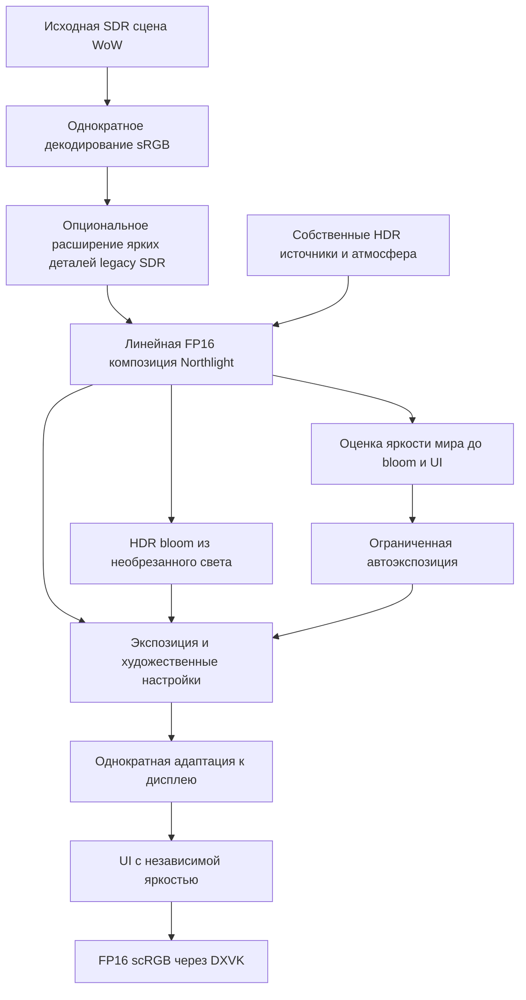

# Спецификация HDR Northlight

Статус: согласована; код первого этапа реализован. Перенос между физическими дисплеями отложен по согласованию; визуальная приёмка игровых сцен и бюджет полного кадра ещё не подтверждены. Дата: 2026-10-31.

Первый этап сохраняет яркость освещения Northlight в линейных FP16-буферах до финального отображения, добавляет автоэкспозицию и калибровку, обеспечивает переход между SDR- и HDR-дисплеями без перезапуска игры. Обычные поверхности сохраняют привычный характер изображения; дополнительные яркость и детализация приходятся преимущественно на источники света, блики и свечение.

## Обязательный результат

Первый этап охватывает собственное освещение Northlight, GI, солнце и луну, атмосферу, рассеяние света и bloom. Источники получают запас яркости выше обычного белого до преобразования для дисплея. Отключение bloom сохраняет HDR-яркость самого источника.

Обязательная платформа — Windows с поставляемыми DXVK 2 и DXVK 3. Поддерживаются обычное окно и безрамочный полноэкранный режим. Сохраняются существующие варианты MSAA и логические backbuffer-буферы клиента. Целевой прирост времени GPU-кадра относительно текущего рендера — не более 5%, включая автоэкспозицию.

Оригинальная сцена WoW остаётся SDR-источником для композиции. Для неё добавляется опциональный Legacy highlight expansion. Восстановление уже обрезанных деталей не производится. Сквозной HDR оригинальных заклинаний и частиц требует отдельного этапа с перехватом до потери диапазона. Wine/Linux проходят отдельную проверку; эксклюзивный fullscreen и нативный D3D9 HDR выходят за рамки первого этапа.

SDR сохраняет текущий вид. Автоэкспозиция и новый HDR-tonemapping работают в HDR-ветке. Переключение обратно в SDR возвращает существующее отображение сцены.

## Причины текущих ограничений

Текущий [HdrWorld](../../shaders/hdr_effects.hlsl) получает готовую 8-битную сцену, декодирует sRGB, применяет contrast/exposure и масштабирует результат через paper white. Peak только уменьшает значения выше установленного предела. При contrast=1 и EV=0 исходное белое не превышает paper white: peak 7298 при white point 200 закономерно оставляет максимум мира на уровне 200 нит.

В [HDR presentation](../../src/proxy/hdr_presentation.h) активация привязана к созданию устройства и Reset. Объявленный GetCurrentOutputDesc не используется. Northlight не повторяет проверку при переносе окна, поэтому первоначальный отказ на SDR-дисплее может сохраняться после переноса на HDR-дисплей.

Промежуточные поля освещения и тумана в [world renderer](../../src/world/world_renderer.h) уже используют FP16. Однако [world composition](../../shaders/world_effects.hlsl) работает с закодированной исходной сценой и возвращает результат в legacy target. Bloom содержит SDR-ограничения, а [солнце и луна](../../shaders/celestial_disc_effects.hlsl) ограничивают собственную эмиссию до финальной конверсии. Смена только формата последнего буфера эти потери не устраняет.

## Порядок обработки кадра



### Линейная композиция

Исходный SDR-цвет декодируется ровно один раз. Все складываемые и вычитаемые члены освещения, восстановление цвета поверхности, GI и атмосферная композиция получают явно заданные совместимые единицы и линейное представление. Существующая защита от двойного освещения сохраняется. Оценка материала из уже освещённого SDR-изображения остаётся приближением; её нельзя выдавать за исходное физически калиброванное albedo.

Собственные источники, включая диски солнца/луны и световое рассеяние, не проходят через 8-битный target перед HDR-композицией. Значения выше обычного белого сохраняются в FP16 до выходного преобразования. Ограничения масок, глубины и прозрачности сохраняют свой смысл независимо от диапазона цвета.

Bloom извлекает свет до ограничения для дисплея и до наложения UI. Его энергия согласована с экспозицией мира, а UI не порождает свечение мира. Добавляется один общий регулятор силы HDR bloom: 0 выключает свечение, 1 задаёт базовый сдержанный вид, диапазон — 0–2. Это множитель относительно нового базового HDR-bloom, а не перенос текущего внутреннего коэффициента .08 в линейный домен без проверки. Регулятор действует только в HDR-ветке. Яркость источников определяется сценой, а peak описывает возможности вывода и не заставляет каждый источник достигать максимума дисплея.

### Отображение и UI

Paper white задаёт яркость обычного белого. Выходная кривая нейтральна, монотонна и плавно сжимает яркие детали к effective peak. Она сохраняет оттенки без дополнительного кинематографического окрашивания. Contrast применяется вокруг опорного серого в линейной HDR-ветке и при значении 1 нейтрален. Exposure и contrast не обрабатывают UI.

При нулевой экспозиции и нейтральном contrast обычное белое отображается в paper white, пока дисплей допускает это значение. HDR-источники способны превышать paper white. Рост peak расширяет доступный диапазон ярких деталей, сохраняя обычные тона. Нужное сжатие near-peak и поведение насыщенных цветов проверяются цветными градиентами; независимое обрезание RGB-каналов не должно создавать сдвиг оттенка.

Вывод остаётся линейным FP16/scRGB: нейтральный RGB 1 соответствует 80 нит, RGB 12,5 — 1000 нит. Преобразование в PQ поверх scRGB не выполняется. Это единицы сигнала приложения; физическую яркость панели можно подтвердить измерителем, а не одним программным overlay. [Windows Advanced Color](https://learn.microsoft.com/en-us/windows/win32/direct3darticles/high-dynamic-range).

После отображения мира применяется отдельная конверсия UI с сохранением premultiplied alpha, существующих вариантов смешивания и доказанной границы world/UI. Яркость нейтрального белого UI определяется только UI brightness. Изменение UI brightness не влияет на оценку экспозиции мира. Сохраняются обработка копирований, чтение логических backbuffer, восстановление шейдеров и неизменённых констант клиента.

### Расширение ярких деталей legacy SDR

Legacy highlight expansion — управляемое inverse tone mapping исходного SDR-слоя. По умолчанию значение 0 выключает его; регулятор 0–2 EV ограничивает максимальное усиление ярких деталей величиной от 1 до 4 раз. Он действует после декодирования SDR и до добавления собственного HDR-освещения. UI и уже сформированная HDR-энергия Northlight в этот оператор не входят. В SDR-ветке настройка не действует.

Оператор сохраняет оттенок, применяя общий множитель к RGB. Плавный порог по интенсивности и ограниченная оценка локального контраста выделяют яркие детали; равномерное светлое поле не должно целиком подниматься к peak. Метод остаётся эвристикой: одинаковые SDR-пиксели без дополнительных сведений о материале не позволяют надёжно отличить белую поверхность от источника света. Настройка не заявляет восстановление потерянной текстуры или физической энергии оригинальных эффектов.

Сила расширения задаётся в пространстве сцены и не зависит от peak дисплея. Отображение для текущего дисплея применяется один раз в конце. Ограничение усиления, пространственная оценка и переходы проверяются на белых поверхностях, малых светящихся объектах, насыщенных цветах и движении камеры. Недопустимы резкие пороги, ореолы на границах, заметное мерцание и повторное усиление собственных HDR-источников.

## Автоэкспозиция

По умолчанию действует Auto; Manual отключает автоматическую поправку. В Auto существующий EV становится пользовательской компенсацией. В Manual он задаёт экспозицию напрямую:

```text
Auto:   EV_total = EV_auto + EV_user
Manual: EV_total = EV_user
gain = 2 ^ EV_total
```

EV_auto ограничивается диапазоном от -2 до +1 EV относительно авторского базового отображения. Пределы доступны в расширенных настройках; ручная компенсация остаётся отдельной. Auto уменьшает яркую сцену максимум в четыре раза и повышает тёмную максимум вдвое. EV_auto не зависит от выбранного peak или монитора.

Оценка использует яркость мира до выходной кривой, bloom и UI. Она должна быть устойчива к небольшим ярким источникам и кратким вспышкам. Начальный способ — оценка логарифмической яркости на уменьшенном GPU-изображении с подавлением выбросов и временной фильтрацией; окончательные параметры фиксируются по эталонным сценам. Постоянный CPU-readback полного кадра и ожидание GPU для выбора экспозиции исключаются.

Авторский базовый уровень учитывает существующее время суток, региональное освещение и NightBrightness. Постоянное приведение всех сцен к одному среднему серому не допускается. Ночь остаётся темнее дня, а тёмное помещение отличается от солнечной улицы. На эталонных сценах фиксируются средние тона, распределение яркости и отношение дневной/ночной яркости для визуального согласования.

Адаптация выполняется во времени в EV, независимо от частоты кадров. При снижении экспозиции 90% изменения достигается примерно за 0,5 секунды; при повышении — за 2 секунды. Для экспоненциального перехода коэффициент обновления равен `1 - exp(-ln(10) * dt / T90)`. Применение пользовательской компенсации не изменяет внутреннюю историю автоматической поправки.

Обычный поворот камеры и движение сохраняют плавную адаптацию. Небольшое солнце/фонарь и короткая локальная вспышка не должны заметно гасить остальной кадр. Смена освещённости большей части мира вызывает адаптацию с заданными временами.

Во время загрузки, отсутствия достоверной сцены и свёрнутого окна оценка приостанавливается. После загрузочного экрана или подтверждённой смены локации новая оценка инициализируется до показа первого валидного кадра. Если сцену ещё нельзя оценить, применяется ограниченный авторский базовый уровень. Для перехода между дисплеями сохраняется EV_auto; при пересоздании ресурсов его последнее значение восстанавливается.

## Настройки и однократный сброс

Калибровка дисплея хранится отдельно для каждого монитора. Художественные настройки сцены общие. Профиль привязывается к устойчивой идентичности дисплея; номер монитора и изменяющийся runtime handle не являются единственным ключом.

| Параметр | Начальное значение после сброса | Область |
| --- | --- | --- |
| HDR output | Включён запрос HDR; при недоступности — SDR | Общий |
| Paper white | 203 нит | Дисплей |
| UI brightness | 160 нит | Дисплей |
| Peak mode | Auto | Дисплей |
| Ручной peak | 1000 нит, используется в Manual | Дисплей |
| Exposure mode | Auto | Сцена |
| Exposure / compensation | 0 EV | Сцена |
| Contrast | 1 | Сцена |
| HDR bloom strength | 1; 0 выключает, диапазон 0–2 | Сцена, только HDR |
| Legacy highlight expansion | 0; диапазон 0–2 EV | Сцена, только HDR |
| Пределы автоматической поправки | -2 / +1 EV | Сцена, расширенные |
| Адаптация к свету / темноте | 0,5 / 2 секунды до 90% | Сцена, расширенные |

Первый запуск версии с новым HDR-пайплайном однократно сбрасывает прежние параметры HDR целиком. Старые paper white, UI brightness, peak, contrast и exposure не мигрируют в новые значения или профили. Прежнее значение ExperimentalHDR также сбрасывается: запрос HDR output становится включённым. Экспозиция и peak после сброса — Auto; остальные значения приведены в таблице. На SDR-дисплее это даёт SDR с сохранённым запросом HDR для последующего переноса окна. Область сброса ограничена HDR-параметрами; остальные настройки рендера, включая NightBrightness, сохраняются. Последующий ручной выбор HDR output сохраняется и не отменяется при следующих запусках.

Для существующих численных контролов сохраняются диапазоны: paper white 80–400 нит, UI brightness 40–400 нит, Manual peak 80–10000 нит, contrast 0,5–2 и пользовательский EV от -4 до +4. Расширенные пределы Auto проверяются на конечность и порядок min ≤ max; времена адаптации должны быть положительными.

Версия миграции и новые значения записываются одной транзакцией через существующий сервис настроек. Повторный запуск, перенос окна, обновление профиля дисплея и переключение HDR не повторяют сброс. Ошибка записи видна пользователю; маркер успешной миграции не ставится раньше сохранения значений.

Все HDR-настройки, включая HDR output, применяются без перезапуска на безопасной границе кадра. Save/Revert и live preview используют существующий контракт меню. Переключение монитора выбирает его профиль и не переносит несохранённый draft одного дисплея в профиль другого.

## Возможности дисплея и переключение вывода

Auto peak использует валидные сведения текущего дисплея из Windows с учётом доступных системных переопределений. Min luminance, peak luminance и full-frame luminance различаются и показываются раздельно, если доступны. Полноэкранная яркость не подменяет пик малого яркого участка. Windows сообщает эти характеристики через [DXGI_OUTPUT_DESC1](https://learn.microsoft.com/en-us/windows/win32/api/dxgi1_6/ns-dxgi1_6-dxgi_output_desc1).

Если достоверный peak недоступен, используется 1000 нит с явной пометкой Fallback. Manual использует заданное пользователем значение. Отображаются источник, запрошенное и effective значения. Числа проверяются на конечность, положительность и согласованность. Если peak ниже выбранных уровней белого, effective paper white/UI white ограничиваются доступным peak, а сохранённые предпочтения отображаются отдельно от ограничения.

Основным считается дисплей с наибольшей площадью пересечения с окном; переключение стабилизируется около границы дисплеев. Отслеживаются перенос и изменение размера окна, HDR toggle Windows, смена конфигурации дисплеев, hotplug и возвращение после сворачивания. Возможности обновляются также после изменения системного цветового профиля. При изменении конфигурации нельзя полагаться только на устаревший output swapchain. [Рекомендации Windows для динамических возможностей дисплея](https://learn.microsoft.com/en-us/windows/win32/direct3darticles/high-dynamic-range).

| Событие | Требуемое поведение |
| --- | --- |
| Запуск на SDR при включённом запросе HDR | Корректный SDR; запрос HDR остаётся сохранённым |
| Перенос SDR → HDR | Повторная проверка, выбор профиля, активация HDR без перезапуска |
| Перенос HDR → SDR | Возврат к существующему SDR-отображению |
| Перенос HDR → другой HDR | Профиль и отображение для нового дисплея; экспозиция мира сохраняется |
| HDR Windows выключен / включён | SDR fallback / автоматическое восстановление HDR при сохранённом запросе |
| HDR output выключен / включён в Northlight | Живой переход без перезапуска; при недоступности HDR — SDR и причина |
| Hotplug, Alt-Tab, resize, смена MSAA | Восстановленные корректные ресурсы, состояние UI и логические backbuffer |
| Ошибка проверки или выделения ресурсов | Рабочий SDR, причина отказа, сохранённый запрос HDR; повтор при релевантном изменении состояния |

Короткая пауза или затемнение при перенастройке допускаются. Длительность переходов измеряется. Перенастройка сериализуется с командным потоком и выполняется с корректным временем жизни ресурсов. Ежекадровые тяжёлые Reset, повторные попытки неисправной конфигурации и блокирующая проверка возможностей не допускаются.

Механизм переходов проверяется первым на DXVK 2 и 3: обновление возможностей после переноса, доступность FP16/scRGB при первоначальном SDR-выводе, изменение presentation при живых ресурсах игры. Безопасность внутреннего device Reset нельзя предполагать по успешной начальной активации. Выбор сохранения FP16 presentation или иной перенастройки определяется этим экспериментом. Если потребуется изменение backend, оно оформляется отдельным конкретным изменением и проходит ту же матрицу проверки. Требование перехода без перезапуска сохраняется.

## Калибровка и диагностика

В Renderer & HDR добавляется небольшой режим калибровки. Он содержит нейтральные участки известного уровня сигнала, настройку обычного белого и UI, яркие градиенты для оценки peak, цветные HDR-участки для проверки оттенков. Предусматриваются малый яркий участок и широкое поле, чтобы видеть различие пиковой и полноэкранной яркости.

Калибровочные участки генерируются в единицах выходного сигнала и обходят автоэкспозицию, contrast, bloom и художественную кривую мира. В тесте peak диапазон определяется проверяемым кандидатом: выбранный scene peak не должен заранее обрезать шаблон и создавать ложную точку исчезновения деталей. UI-инструкция и обычное меню сохраняют заданную UI brightness.

Краткая диагностика показывает текущий дисплей, backend, запрошенное/активное состояние HDR, причину fallback, формат/цветовое пространство вывода, peak и его источник Auto/Manual/Fallback, effective уровни белого. Информация о яркости явно обозначается как уровень сигнала приложения, а не измерение панели. Расширенные средства могут получать GPU-статистику по запросу, без полного readback кадра в обычной игре.

## Проверка результата

### Числа и порядок обработки

| Проверка | Ожидаемый результат |
| --- | --- |
| Нейтральный калибровочный сигнал 80 / 203 / 1000 нит | scRGB RGB 1 / 2,5375 / 12,5 с допуском FP16 |
| Paper white 200, Manual EV 0, contrast 1, peak 1000 | Обычное белое около 200 нит; собственный яркий источник способен превысить 200 нит |
| Изменение peak при фиксированном линейном входе и EV | Стабильные обычные тона; меняется отображение ярких деталей |
| Выключение bloom | HDR-яркость источника остаётся; исчезает его bloom |
| Изменение UI brightness при фиксированной сцене | Меняется только UI; оценка экспозиции мира стабильна |
| Цветные градиенты и очень яркие источники | Плавное сжатие, отсутствие NaN/Inf и сдвига оттенка из-за поканального clipping |
| Legacy highlight expansion 0 / больше 0 | При 0 исходное SDR-размещение неизменно; локальные яркие детали получают ограниченное усиление, равномерное белое поле сохраняется |
| Изменение expansion при фиксированных собственных HDR-источниках | UI и собственные HDR-источники напрямую не усиливаются; peak не управляет силой expansion |
| Изменение уровней мира и UI в соседних кадрах | Нет trails, замороженных копий, повторной конверсии или пропущенных UI-draw |

Для калибровочных значений допускается погрешность до 0,2% на уровне FP16-сигнала. Проверки самого shader-output дополняются наблюдением на реальном HDR-дисплее: корректный FP16-буфер ещё не доказывает корректный desktop output.

Автоэкспозиция отдельно проверяется на пределах, компенсации EV, временах T90 при нескольких частотах кадров, локальных ярких источниках, коротких вспышках, загрузке и непрерывном движении. При одинаковой сцене изменение UI, bloom, peak или монитора не меняет EV_auto. Дневная улица, ночь и интерьер включаются в визуальные эталоны с проверкой NightBrightness.

### Совместимость и переходы

Матрица запускается для DXVK 2 и 3, обычного и безрамочного окна. Она включает оба направления SDR/HDR, HDR/HDR с разными профилями, запуск на каждом типе дисплея, системный HDR toggle, переключатель Northlight, hotplug, Alt-Tab и resize. Статус active подтверждается фактическим состоянием вывода.

Сохраняются и расширяются существующие проверки logical backbuffer, Device/SwapChain Present, нескольких буферов, MSAA off/2x/4x/8x, смены samples при Reset, readback, UI-boundary с эффектами on/off, shader/state restoration и отрицательных примеров классификации UI. Старый oracle, ожидающий максимум paper white из SDR-источника, остаётся полезным для legacy-входа; собственный HDR-вход требует новых положительных проверок headroom.

SDR сравнивается с текущей веткой на одинаковых сценах и настройках. Миграция проверяется как одноразовая: первый запуск сбрасывает все прежние HDR-значения, второй сохраняет новые настройки, переключение дисплеев сохраняет отдельные профили, ошибка записи не отмечается успешной миграцией.

### Производительность и память

До изменения кода фиксируется baseline текущего рендера. Сравнение выполняется на одном GPU/драйвере, одинаковых сценах, разрешении, MSAA и настройках, после прогрева шейдеров. Отдельно измеряются текущий и новый HDR, а также SDR для контроля регрессий. В новый HDR включены Auto, bloom и обычный UI; калибровка и расширенная диагностика измеряются отдельно.

Проверяются дневная сцена, ночь, интерьер, насыщенный источниками участок и сцена с атмосферой; разрешения — 1080p, 1440p и 4K при доступности оборудования. Фиксируются среднее время GPU-кадра, p95, стоимость новых проходов и условия запуска. Цель 5% оценивается по среднему времени каждой представительной сцены; p95 сохраняется для обнаружения новых задержек. Превышение сопровождается измеренным разбором и оптимизацией, без скрытого снижения качества.

Повторно используются существующие FP16-ресурсы и сервисы. Каждый новый полноразмерный target включается в учёт памяти и времени жизни, включая MSAA и ресурсы пересоздания. Один RGBA16F target 3840×2160 без MSAA содержит 63,28125 MiB данных; это размер payload, а не оценка всего процесса. Учитываются ограничения x86, повторные переходы и отсутствие накопления ресурсов. Текущий manifest сообщает 363/512 ps_3_0 slots для WorldComposite; старый комментарий 512/512 в исходнике устарел. Новые HDR-варианты проходят фактическую проверку slots и регистров после компиляции.

## Последовательность реализации

1. Зафиксировать baseline и воспроизведение исходных проблем; доказать жизненный цикл SDR/HDR на обоих DXVK с живыми ресурсами и логическими буферами клиента.
2. Определить линейные единицы источников и композиции, провести собственную HDR-энергию через FP16, реализовать нейтральное отображение и сохранить отдельный UI. Подтвердить headroom при фиксированном Manual EV.
3. Перенести bloom на необрезанный HDR-вход, добавить опциональный Legacy highlight expansion и проверить собственные свет, атмосферу, солнце/луну и их сочетания.
4. Добавить GPU-оценку яркости, Auto/Manual, ограничение и временную адаптацию. Настроить базовый уровень по дневным, ночным и интерьерным эталонам.
5. Добавить профили дисплеев, Auto/Manual peak, однократный полный сброс HDR-настроек, live-переключение меню, калибровку и диагностику.
6. Пройти численные, GPU-интеграционные и реальные дисплейные проверки, сравнить SDR, измерить бюджет времени и памяти. Обновить документацию фактического HDR-поведения.

Спецификация задаёт согласованные требования к результату. Проверка жизненного цикла вывода выполняется до изменения цветового пайплайна.
