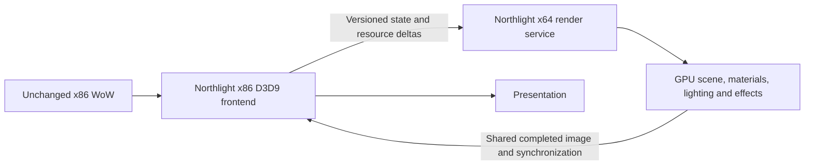

# Northlight rendering replacement: a twelve-month proposal

Status: rejected direction. The selected architecture investigation stays in the
existing x86 process; see [the x86 plan](northlight-x86-rendering-plan.md). This
document retains the alternative and its costs, not an implementation commitment.
Constraint: leave `wow.exe`, game logic and wow_optimize unchanged. Preserve actual
effect coverage, HD assets, MSAA and the current aggregate memory budgets.

The strongest project would make Northlight own rendering preparation and GPU
execution, with a small x86 D3D9 compatibility frontend and a separate x64 render
service. The client would remain x86. Vulkan is the first backend candidate because
the current path already uses DXVK; D3D12 is a viable alternative, not a second
backend to build simultaneously.

External GPU memory and synchronization are supported mechanisms, not proof that
the current DXVK interface can simply be moved across processes. Resource format,
handle ownership, backend interoperability and presentation must be proven first.
There must be no per-frame GPU-to-CPU-to-GPU image copy.

## One execution owner, not two renderers drawing the same scene

The frontend must replace execution of migrated commands, rather than forwarding
them to the current x86 backend and asking the service to draw them again. WoW
still performs its own CPU preparation and calls D3D9; the shim records/encodes
those calls. The service executes the corresponding GPU work once. Initially,
that can be compatible D3D9 replay in x64; semantic replacements follow later.

During incremental migration, each pass/resource version has exactly one
execution owner. A compatible fallback replaces the migrated pass rather than
adding a second full-scene render. Native API queries, locks and completion must
refer to that real owner. Presentation of a shared completed image is not a
second scene render, although transfer and synchronization overhead still count.

CPU duplication remains a real risk: WoW builds its native draw stream and the
service must consume it. A retained scene should make that consumption incremental
instead of rebuilding geometry/materials each frame. Moving the existing repeated
work to another process without removing it is not an optimization. The x64 split
is conditional on measurements; an in-process modern renderer remains preferable
if IPC or compatibility costs erase the memory/preparation benefit.

## Work that should disappear

1. **Repeated scene reconstruction.** Keep immutable meshes, texture versions,
   material programs and instance identities resident. Send camera, transform,
   pose and resource deltas. Retain exact DISCARD/NOOVERWRITE, resource mutation,
   ownership and reset epochs. A reused pointer is not a stable resource identity.
2. **Repeated material evaluation.** Preserve native color, alpha discard, depth,
   stencil and sample coverage while producing the inputs Northlight needs during
   the original eligible draw. Reuse the same POM solution across consumers.
   Unsupported material/order cases retain the compatible path. The current Shared
   POM implementation still does not provide complete native-color/capture fusion.
3. **Repeated deformation and submission.** Reuse a current, identical GPU skin
   result across owned passes where that costs less than repeating the VS. Keep
   compatible instance groups resident; let GPU visibility produce indirect draw
   lists. Native shader skinning already runs on the GPU for supported M2 draws:
   moving it to compute without reuse is not inherently an improvement.
4. **View-dependent re-evaluation of stable lighting.** Cache static visibility and
   transport in world/light space; invalidate moving-caster and changing-source
   regions precisely. Use conservative empty-space/tile skipping and a dense-case
   fallback. A camera turn should chiefly change visibility and sampling, rather
   than reconstructing all transport. Temporal reuse must not retain old poses or
   invent illumination where current occlusion is unknown.
5. **Per-draw CPU light selection limits.** Own clustered local lighting for world,
   characters and glue scenes, with stable source identity and source-matched
   shadowing. This can replace native four-slot limitations for supported rendering
   paths. Preserve authored source animation and avoid adding a second copy of
   already-applied native light.
6. **Synchronous preparation and cold compilation.** Build immutable asset and
   pipeline data on workers, prewarm compatible pipelines and stream bounded
   updates before visibility. Jobs that immediately join before every draw simply
   move the same stall. Never report an unfinished EVENT query as complete.

## Boundary and hard ceiling

A D3D9 frontend cannot undo client work already completed before the API call.
Lua, gameplay, native animation/culling and asset preparation can remain the
limiting producer even with an ideal Northlight renderer. If irreducible client
work takes 10 ms per frame after renderer-induced waits are removed, the real
frame-rate ceiling is 100 FPS. A 120 FPS display stream cannot be counted as
120 newly simulated/rendered game frames through frame generation or stale poses.

The first milestone therefore measures useful client CPU work separately from
queue/GPU waits and the FPS limiter. A replay omits live Lua and simulation; its
FPS alone cannot establish the live-client ceiling. Higher-level read-only scene
publication may improve semantic reconstruction, but bypassing or rewriting game
logic is outside this proposal's unchanged-client boundary.

The x64 service removes Northlight-owned allocations from the client's limited
virtual address space. It does not automatically reduce total RAM, enlarge VRAM,
or make memory pressure disappear. Account frontend, service, staging, histories
and driver-visible resources together. Shared storage should replace duplicate
copies. The current full-resolution normal/occlusion MSAA twins would require
substantial extra memory; reproducing that layout in x64 is not a budget solution.

## Delivery plan

| Months | Deliverable | Gate before proceeding |
|---|---|---|
| 1–2 | Complete private frame/resource replay; main-thread CPU floor; x86/x64 shared-resource and query prototype | Same scene/state/sample coverage; correct completion/reset/lifetime semantics; bridge cost measured independently |
| 3–4 | Bounded service and persistent asset/resource registry, initially running compatible rendering | No full-frame readback; unchanged output; aggregate memory within the current cap; frontend/IPC overhead does not exceed the existing replay path |
| 5–6 | Eligible opaque native/material fusion and current-pose reuse | Native color, cutout, order, HDR and 2x MSAA oracles; a net gain including resolve/bandwidth and fallback costs |
| 7–9 | GPU visibility/indirect submission, clustered lights and sparse volumetric transport | Sparse, dense, crowd, spell and rotation workloads improve without effect omissions or stale history |
| 10–12 | HD/zone/menu coverage, cold-cache streaming, recovery and release hardening | Multi-minute live runs and complete replays; p50/p95/p99, input latency, effect masks and RAM/VRAM accounting; vendor/backend coverage |

120 FPS means a frame budget of 8.33 ms. This is an acceptance target, not a
predicted uplift. Define the target scenes, resolution and quality first; retain
all active effects. Judge cold rotation and dense cases as well as static medians.
An optimization that improves a sparse microbenchmark but regresses dense views
should remain an experiment until selection or a better algorithm is proven.

## Foundations and references

- The repository's `wowdecomp-offload-audit-20261026.md` identifies work already
  performed by the client, current worker/streaming support and API intervention
  boundaries. It is a historical source audit, not a new runtime measurement.
- [Khronos: external memory and synchronization](https://docs.vulkan.org/guide/latest/extensions/external.html)
  and [Win32 external memory](https://docs.vulkan.org/refpages/latest/refpages/source/VK_KHR_external_memory_win32.html)
  describe sharing and capability/ownership requirements across APIs/processes.
- [Microsoft: indirect drawing](https://learn.microsoft.com/en-us/windows/win32/direct3d12/indirect-drawing)
  describes GPU-generated draw lists and supported state changes.
- [Microsoft: D3D9 GetData](https://learn.microsoft.com/en-us/windows/win32/api/d3d9/nf-d3d9-idirect3dquery9-getdata)
  defines real query availability, flushing and device-loss behavior.

The first practical investment is the complete replay and CPU-floor measurement.
Those tools both guide this larger project and make current optimizations safer.
