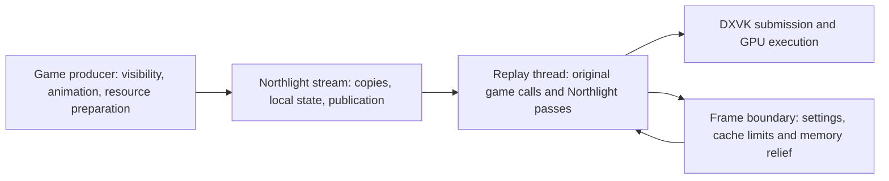

# Rotation stalls: architecture, scene inputs and implementation status

Status: investigation and implementation in progress. The 120 FPS acceptance
criterion has not been achieved or verified. No changes from this iteration
have been published. The client and wow_optimize were not run or modified.

## Runtime identity and timing domains

The fresh run ends near 03:29 on 24 October 2026. It loaded the delivered
`e15cc6d` DLL: startup source identity
`46b7faf3fdc17f62391fd2a025f428752a37641a8809f69a6e7c4abe2be59747`.
The source baseline for this investigation is report-only follow-up `0cac160`.
DXVK 3.1.1, 3840 x 2160, MSAA 2x and HDR were active.

Immutable evidence is under
`northlight-diagnostics/rotation-architecture-20261024-0330`.
Each worker reviewed five directions: stream/native/AO, GI/terrain/memory and
materials/emission/artifacts. Their English audits and JSON evidence retain
raw log lines, settings observations and timing-domain qualifications.

Queue idle is time when C lacks published input from A/B. It is not GPU shader
time. API wall time may include driver waits. GPU timestamp intervals may
include periods without submitted work. These domains overlap; adding their
medians does not produce a valid frame cost. Worker build latency is another
domain and is not charged to a rendered frame unless a measured join blocks it.

## What now explains the stalls

| Evidence | Conclusion | Action |
| --- | --- | --- |
| 188 of 192 retained long gaps start with recorded = published = replayed; 98 are BeginScene to UnlockRect without observed queue waits. | The largest gaps are missing producer input. Smaller publication batches cannot produce commands the game has not issued. | Identify outstanding texture locks, their actual callers and fill intervals; sample producer kernel/user CPU time at idle boundaries. |
| Stream frame 22722, log L42538: 249.425 ms empty queue, only four new commands at exit; sync/Present/backpressure/record/snapshot deltas zero, Lock API delta 7,726 ns. | This is consistent with native preparation, texture filling, scheduling or external waiting. The specific routine is still unknown. | Preserve queue/query/wake behavior. New diagnostics distinguish CPU activity from off-CPU time and join lock observations by monotonic time/token. |
| Renderer frame 22722, L42553: 278.492 ms frame, 250.589 ms scene queue idle, 3.195 ms query-pending span and 0.006 ms actual GetData wall. | GetData call cost does not explain this frame. Similar stream/renderer frame numbers alone do not prove a join. | Keep separate domains and correlate using timestamps. |
| Frame 4284: 39.025 ms memory work; material caps 21.176 ms, terrain clear 7.019 ms, snapshot/index clear 4.240 ms. Frame 5671: 35.651 ms; corresponding phases 20.186/7.512/5.733 ms. | Synchronous cache relief is a directly measured Northlight frame-boundary stall. | Remove shrink-then-clear work, instrument remaining material subphases, evaluate bounded CPU-only retirement with full retained-byte accounting. |
| Terrain frame 18415: 571 misses, 573 byte evictions, 8.349 ms capture maximum; every cold miss uses direct XYZ copying and no raw-span temporary. | The previous copy optimization works; capacity churn/allocation/classification remain. | Reproduce the working-set transition on the new MPQ corpus. Do not raise cache caps blindly. |
| 1,827 of 1,834 staged worker reclaims start with empty source/preparation caches. | Repeated worker reclaim attempts are wasteful, but multi-second admission episodes are not individual frame costs. | Investigate bounded retry/reclaim epochs while retaining VA floors and usable published geometry. |

The final complete stream window has 69,249 express query posts and hits, zero
fallbacks, approximately 7,133 commands per frame and 9.459 ms replay busy per
frame. This is a window average, not a controlled static/rotating comparison.
All 224 sampled TERRAIN_SWAP rows have zero native calls; optimizing that
wrapper cannot explain this run's major cost.

## Settings must be treated as separate experiments

Fourteen Effects OFF intervals last only 281-937 ms. Toggling resets the
120-frame statistics window, so none produces a complete OFF frame-time window.
The three OFF CPU samples report 0.196/0.135/0.129 ms Northlight work, not full
frame latency. There is no defensible native-only FPS baseline in this log.

Startup uses SSAO/High, but log L8019 switches live preview to GTAO. Before that
boundary the 29 sampled AO passes have median 0.115 ms; later 184 samples have
median 0.523 ms. Different scenes and visibility prevent an A/B uplift claim.
Sampled M2 settings change at frames 11430 (off), 11811 (mode 2), 12065 (mode 3),
14097 (off), 14478 (mode 3); grass changes at 16129. Sampled transitions are
brackets, not exact application times.

New logging preserves partial frame windows before master/component/settings/
AO-preview changes and records effective quality-setting deltas with device, renderer
frame, revision and steady-clock timestamps. A short OFF observation is labeled
partial, rather than discarded or presented as a complete 120-frame window.

## Implementation decisions and quality invariants

1. **Texture and producer attribution.** Bounded active/recent lock records
   retain Lock entry/return, Unlock entry, route, resource metadata and actual
   Lock caller. Overflow, failed CPU queries and unstable concurrent copies
   remain unknown. A read-only producer thread handle measures CPU counters;
   no thread suspension or scheduling/query changes are introduced. Rare
   producer-side long-lock reports resolve module/offset without using the
   existing producer-only formatter on the replay thread.
2. **Material pressure relief.** A mandatory full source-cache clear precedes
   lowering its limit. Previously the limit reduction could LRU-evict entries
   immediately before clearing the same pool. Apply the same rule to the three
   displacement source pools. No allocation/admission occurs between clear and
   cap update. Escaped immutable snapshots retain their ownership; COM release
   stays on the device thread. Skip GlobalMemoryStatusEx only where the pressure
   path selects a fixed budget without reading its result. New subphase timings
   identify which remaining operation owns the observed 20-21 ms.
3. **Particle capture.** Reuse the exact three evaluated probe vertices for the
   same sampling iteration within one prepare call. Sample count, texture/PS
   evaluation, color, intensity, geometry and distance/frustum tests stay intact.
4. **Live equipment-light registration.** Shader metadata must be collected at
   shader creation even if EquipmentLights is currently OFF. Otherwise enabling
   this live option cannot use shaders created earlier. Retain only positive
   proven native-light slot counts, overwrite/erase on pointer re-registration,
   and keep capture/uploads disabled while the option is OFF. This metadata map
   lives until WorldRenderer destruction; this change does not add a shader
   destruction callback or retain shader bytecode/COM ownership.
5. **Terrain retirement was rejected.** A CPU-only detached payload must
   remain charged until destruction completes, preserve every supported cap,
   use bounded queue storage and fall back synchronously on refusal. No new
   render-frame waits are acceptable. The universal minimum-cap constraint may
   make this slower than bulk clear. The six-cell current-scene comparison
   preserves exact geometry/caps but includes a 16 MiB refused-queue regression
   of 0.080325 ms (6.28%). Other individual cells improve by 0.104-1.139 ms;
   one pair with variable baseline costs does not prove a robust whole-phase
   win. Both production files were restored byte-for-byte to `0cac160`.

MSAA, resolution, source coverage, geometry, distance limits, High AO defaults,
material sample counts and frame pacing are not reduced to meet the target.

## The new test environment and the missing full-scene inputs

`scripts/prepare_rotation_scene.py` freezes a camera/settings log, copies every
referenced static cache dependency and optionally extracts terrain from active
MPQs using the existing reader. Missing, malformed, changing or over-budget
inputs fail or remain explicitly incomplete. It never modifies installed data.

The current private corpus contains 1,557 camera observations, 25 complete MPQ
ADTs, 3,200 terrain packets and 1,660 static files (297.412 MiB), including FGS3
placements, referenced FGS2 meshes and local lights. Its manifest explicitly
states `full_scene_replay_ready=false` and `fps_acceptance_proven=false`.

Still required for a faithful full-frame replay:

- Ordered original resource/state/draw/update/release commands, with VB/IB
  layouts, native shader bytecode/constants, texture mips and resource lifetimes.
- Animated actor palettes, equipment/particle packets, projection/depth/MSAA/HDR
  surfaces and exact settings transitions.
- Representative static and rotating segments with matching scene/state and an
  uncapped native-only baseline. Effects OFF retains Northlight proxy overhead.
- Images/depth for identical camera frames, including shadow, emission, rain
  and contact-detail checks. A fast terrain-only or precomputed-surface shader
  test cannot establish full-scene quality or game FPS.

A D3D trace is one candidate input source: the official
[apitrace usage documentation](https://github.com/apitrace/apitrace/blob/master/docs/USAGE.markdown)
describes D3D9 command capture and replay. A proxy-chain-safe capture integration
and validation are still needed here; no tracer was installed or game launched.
Replay speed also excludes native application preparation, so it cannot alone
prove that the producer stalls in this log were removed. Do not inject synthetic
sleeps to force an arbitrary matching FPS.

Acceptance remains at least 120 FPS under rotation (8.333 ms frame budget),
preferably 160 FPS, with rotating throughput close to static throughput and
unchanged quality. Inspect CPU/GPU/p99 frame intervals and image evidence on the
same scene. No full test suite is scheduled before this performance gate;
only targeted scenario/invariant checks are appropriate during implementation.

## Current issue disposition

Read-only GitHub issue snapshot: `issues.json` in the diagnostic directory. No
comments, issue closures, PR updates or pushes are authorized for this phase.

| Issue | Current state / evidence needed |
| --- | --- |
| #104 own-call batching | Earlier exact binding/constant reuse remains. Current native wrapper count is zero; new full-scene traces must identify remaining API work before reordering more passes. |
| #102 live particle cost | Same-call probe reuse implemented; output-equivalence and counted-read oracle prepared. No sample reduction. |
| #101 location-dependent light loss | Capture/selection success does not prove the draw contribution. Need matching light/receiver/frame products; do not conflate it with the separately proven live-enable registration bug. |
| #100 native plus particle double lighting | Requires shared source/actor identity and matched light energy; proximity-only suppression could erase a different nearby source. Not claimed fixed. |
| #99 overbright authored fixtures | Multi-emitter fixture stacking and parent-light overlap need fixture-specific corpus and energy checks. Not claimed fixed. |
| #105 AO quality | Already implemented as opt-in levels; defaults remain High. |
| #106 actor halo | Rejected global thickness/actor-MRT variants remain absent. Halo, contact and structural AO plus GPU-cost acceptance must all pass before adoption. |
| #17 state-cache compatibility | Investigate Northlight state restoration only. No wow_optimize edits or settings changes. |

The current run starts with EquipmentLights OFF. It cannot demonstrate that a
particular rogue shoulder asset emits correctly or explain its missing light.
The exact item/model identity and matching emission capture remain necessary.
Angle-dependent shadow and light loss is still an open correctness requirement.

Actual stock MPQ shadow inputs were subsequently prepared privately: 270
ShadowMap VS variants contain nine unique programs, none of whose hashes are
in current world capture signatures. Skinned programs apply an extra c14-c16
affine transform after c31+ skinning; current main-view pose interpretation does
not apply that stage. Their native coordinate frame and actual submission/cull
coverage remain unknown. Do not relax the viewport/projection gates merely to
admit them. The private input manifest and representative decoded tokens are in
`materials/native-shadow-inputs`.

## Focused acceptance completed so far

Six changed-path checks passed; no full suite or old 69-check selection was run:

- Stream attribution: all 15 groups at O2, O0, ASan/UBSan and TSan, including
  actual queue/replayer paths, lock overlap/lifetime/overflow/races, CPU API
  failure and profile-disabled paths.
- Material pressure: actual shared and standalone pools preserve caps, escaped
  immutable data, declaration-release thread, invalidation, recovery and
  allocation-free transitions against the original-order control. Only redundant
  shrink and unused OS-query counters decrease. No elapsed-time uplift claimed.
- Particle capture: 17 full-output/count scenarios per x86/x64 O2/O0 current/
  original-probe control. The indexed probe saves six uploaded-input reads;
  UP behavior remains identical. The wrong-triangle mutant is rejected.
- Equipment: authentic stock shader proofs plus exact production registration
  method, Off-to-On and unsupported/null/pointer-reuse cases; original bug rejected.
- Partial frame-window statistics: short segments, exact percentiles, mode
  isolation and subsequent complete-window behavior.
- Real Win32 producer CPU handle: 156.25 ms CPU during producer work, zero
  additional producer CPU while the observing thread burns CPU and the producer
  waits. This checks the actual Windows API path, separately from fake failure APIs.

All 1,660 copied static files match their manifest hashes; model and light
headers also pass. This is dependency/header validation, not full-scene rendering.
`targeted-acceptance.json` binds adopted results to unchanged production sources.
Earlier failures remain preserved: missing Linux Zig configuration, a clipped
overlap oracle arithmetic error, an unused-variable error in the deliberately
wrong particle mutant, and a standalone compiler command missing `-UNDEBUG`.
Only fixture/command repairs were needed; no assertion tolerance was widened.

The full-frame 120 FPS and visual requirements remain unverified. These focused
checks establish the stated local invariants, not elimination of the native
249 ms stalls or complete resolution of the listed visual issues.

## Private build

Source commit `af006785b77acde7859687e9ea9f9af6a506c902` builds successfully with
Zig 0.15.2. The resulting DLL is 5,733,888 bytes, SHA-256
`488b906f9d6ae119926c8786c7cab070bf061430d096dc52923af3df5b0250e7`.
DLL/PDB GUID and age match without loading the renderer. The build leaves
production sources unchanged and retains the two pre-existing misleading-
indentation warnings in displacement code. The separate package is for manual
use; it is not automatically installed. This report-only follow-up does not
change the built renderer source.
